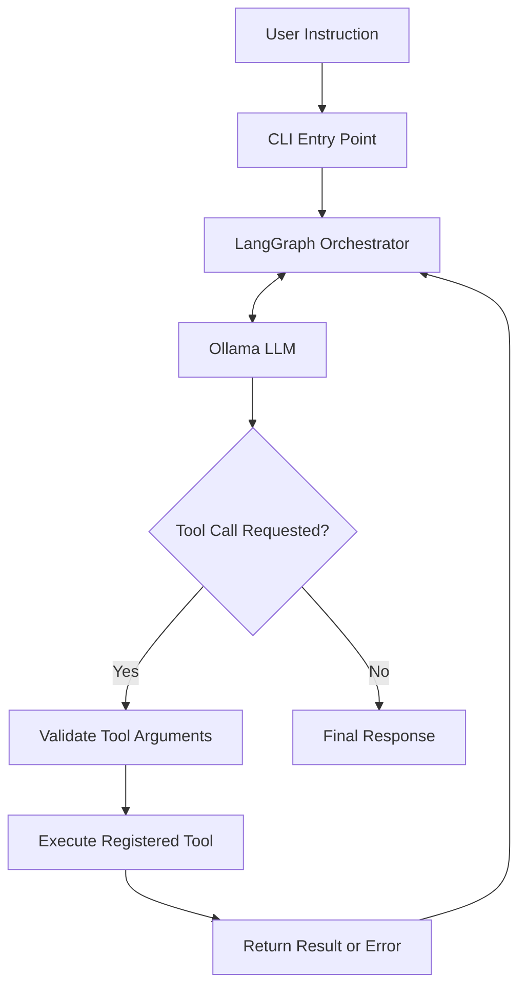

# Build Workflow AI CLI

> A local-first AI agent that transforms natural-language instructions into multi-step workflows using LLM reasoning, tool execution, and stateful orchestration.

**Build Workflow AI CLI** is a TypeScript-based project exploring autonomous workflow automation through the terminal. It combines LangGraph for orchestration, LangChain for model and tool integration, and Ollama for locally hosted inference.

The goal is to move beyond a traditional chatbot by enabling an agent to interpret a task, select from available tools, execute actions, evaluate their results, and determine the next step.

## Table of Contents

- [Overview](#overview)
- [Features](#features)
- [Architecture](#architecture)
- [Execution Flow](#execution-flow)
- [Technology Stack](#technology-stack)
- [Getting Started](#getting-started)
- [Environment Configuration](#environment-configuration)
- [Extending the Agent](#extending-the-agent)
- [Security Considerations](#security-considerations)
- [Known Limitations](#known-limitations)
- [Roadmap](#roadmap)
- [Contributing](#contributing)
- [License](#license)

## Overview

Most AI chatbots generate responses to user prompts. An AI workflow agent takes this further by connecting model-generated decisions to executable application tools.

This project explores a flexible agent architecture in which the model can reason over a task, request tool execution, and use the resulting feedback to continue the workflow.

The intended execution cycle is:

1. **Understand** the user's objective.
2. **Plan** the next action using the available tools.
3. **Execute** the selected action through application code.
4. **Observe** the result or error.
5. **Adapt** the next step based on the feedback.
6. **Finish** by returning a result or explaining the failure.

The objective is to build an extensible automation framework where new capabilities can be introduced as tools instead of requiring a separate hard-coded workflow for every task.

## Features

The project is structured around the following capabilities. The functionality available at runtime depends on the tools and execution logic implemented in the source code.

- **Natural-language task input:** Describe a task using ordinary language.
- **Agent orchestration:** Coordinate model interactions and workflow transitions using LangGraph.
- **Tool integration:** Connect model decisions to application-defined functions.
- **Local LLM support:** Connect to an Ollama model through an OpenAI-compatible API.
- **Structured validation:** Use Zod schemas to define and validate tool inputs.
- **Email integration:** Use Nodemailer for SMTP-based email workflows when configured and implemented.
- **Extensible design:** Add new tools and integrations without redesigning the entire application.
- **Feedback-driven execution:** Allow tool results and errors to inform subsequent agent decisions, subject to the implemented control logic.

## Architecture

The project separates model inference, orchestration, and tool execution into distinct responsibilities.



### Core components

| Component | Responsibility |
|---|---|
| TypeScript | Type-safe application development |
| Node.js | JavaScript runtime |
| LangGraph | Stateful workflow orchestration |
| LangChain Core | Model messages and tool abstractions |
| LangChain OpenAI | OpenAI-compatible model integration |
| Ollama | Local language model inference |
| Zod | Structured input validation |
| Nodemailer | SMTP email integration |
| dotenv | Environment-based configuration |

### Architectural principles

**Separation of concerns:** Model interaction, workflow control, and external actions should remain independently maintainable.

**Controlled tool execution:** The model may request an action, but application code should validate the arguments and determine whether the action is permitted.

**Composable workflows:** New functionality should be introduced through well-defined tools wherever possible.

**Observable execution:** Tool results, failures, and workflow transitions should be logged appropriately to support debugging and reliability.

## Execution Flow

A typical agent interaction can follow this sequence:

1. The user submits a natural-language instruction.
2. The agent sends the relevant context and available tool definitions to the model.
3. The model either returns a response or requests a tool call.
4. The application validates and executes the requested tool.
5. The result is returned to the agent as feedback.
6. The agent decides whether another action is needed or whether the task is complete.

This architecture supports multi-step workflows, but the degree of autonomy depends on the available tools, model capabilities, permissions, and execution limits.

## Technology Stack

| Technology | Purpose |
|---|---|
| TypeScript | Application logic and type safety |
| Node.js | Runtime environment |
| LangGraph | Agent state and workflow orchestration |
| LangChain Core | Message and tool abstractions |
| LangChain OpenAI | Model client integration |
| Ollama | Local model serving |
| Zod | Schema validation |
| Nodemailer | Email transport |
| dotenv | Environment variable loading |
| tsx | TypeScript execution during development |

## Getting Started

### Prerequisites

Before setting up the project, ensure that you have:

- Node.js compatible with the installed dependencies; Node.js 22 or later is a suitable baseline.
- npm.
- Ollama installed and running.
- The required language model downloaded.
- The project source code and environment configuration.

### 1. Clone the repository

Replace the placeholder with your actual repository URL.

```bash
git clone <YOUR_REPOSITORY_URL>
cd ai-agent
```

### 2. Install dependencies

```bash
npm install
```

For reproducible installation from an up-to-date lockfile, use:

```bash
npm ci
```

### 3. Set up Ollama

Download the model configured for the project:

```bash
ollama pull smollm2:latest
```

Verify that the model is available:

```bash
ollama list
```

Check that the OpenAI-compatible endpoint is reachable:

```bash
curl http://localhost:11434/v1/models
```

If Ollama is running on another machine, update the base URL to an endpoint accessible from the application.

### 4. Configure environment variables

Create a `.env` file in the project root.

```dotenv
OLLAMA_BASE_URL=http://localhost:11434/v1
OLLAMA_MODEL=smollm2:latest
OLLAMA_API_KEY=ollama

SMTP_HOST=smtp.gmail.com
SMTP_PORT=465
SMTP_SECURE=true
SMTP_USER=your-email@gmail.com
SMTP_PASS=your-app-password
EMAIL_FROM=your-email@gmail.com
```

The SMTP variables are only required if the application uses email functionality.

### 5. Configure npm scripts

The provided package configuration does not currently define development or production start scripts. Once you confirm the actual TypeScript entry point, you can add scripts such as these to `package.json`:

```json
{
  "scripts": {
    "dev": "tsx src/index.ts",
    "typecheck": "tsc --noEmit"
  }
}
```

Replace `src/index.ts` with your actual entry point if it differs.

A production build also requires an appropriate TypeScript build configuration and output directory.

### 6. Run the application

After configuring the correct entry point and npm scripts, start the application with:

```bash
npm run dev
```

These commands are setup examples; they are not scripts currently defined in the supplied package configuration.

## Environment Configuration

| Variable | Description |
|---|---|
| `OLLAMA_BASE_URL` | Base URL for the model API |
| `OLLAMA_MODEL` | Model identifier available through Ollama |
| `OLLAMA_API_KEY` | API key value expected by the configured client |
| `SMTP_HOST` | SMTP server hostname |
| `SMTP_PORT` | SMTP server port |
| `SMTP_SECURE` | Whether SMTP uses TLS from connection initiation |
| `SMTP_USER` | SMTP authentication username |
| `SMTP_PASS` | SMTP password or provider-issued app password |
| `EMAIL_FROM` | Sender address for outgoing email |

**Important:** Never commit your actual `.env` file or expose API credentials in logs, screenshots, or public repositories.

Create an `.env.example` with placeholder values for contributors, and ensure `.env` is included in `.gitignore`.

## Extending the Agent

The architecture is intended to support additional capabilities through modular tools.

A well-designed tool should have:

- A clearly defined responsibility.
- A structured input schema.
- An asynchronous execution function where necessary.
- Predictable output and error handling.
- Explicit registration with the agent.
- Permission checks for sensitive operations.

Potential extensions include:

| Tool category | Possible functionality |
|---|---|
| File management | Read, create, and organize files within permitted directories |
| Email | Draft, review, and send emails with appropriate approval |
| Web integration | Fetch information from authorized APIs |
| Workflow automation | Chain multiple operations to achieve a goal |
| System utilities | Execute approved commands in a controlled environment |

These are potential extensions, not a claim that every listed tool is already implemented.

## Security Considerations

An agent that can execute tools must be designed with explicit safety boundaries.

- **Validate tool inputs:** Do not assume model-generated arguments are trustworthy.
- **Restrict permissions:** Give each tool only the access it needs.
- **Require approval:** Gate sensitive actions such as sending emails, deleting files, or modifying external systems.
- **Protect credentials:** Load secrets from environment variables and keep them out of version control.
- **Limit execution:** Use timeouts, iteration limits, and resource constraints.
- **Handle errors safely:** Avoid exposing credentials or sensitive internal details in error messages.
- **Sandbox risky operations:** Never grant unrestricted shell or filesystem access merely because an agent requests it.

Local inference can reduce dependence on hosted model APIs, but it does not automatically make the entire application private or secure. External integrations may still transmit data outside the local machine.

## Known Limitations

The current project configuration indicates several areas that require verification or further development:

- Actual capabilities depend on the tools registered in the implementation.
- Small local models may have difficulty with complex reasoning and reliable tool selection.
- Reliable recovery requires explicit retry policies, timeouts, and stopping conditions.
- Email automation depends on valid SMTP configuration and network access.
- Persistent memory and resumable workflows require additional state management.
- Automated tests and continuous integration are needed to verify behavior.
- The supplied package configuration does not yet define runnable npm scripts or a test suite.

These limitations should be reassessed as the implementation evolves.

## Roadmap

- [ ] Establish a consistent CLI interface for user instructions.
- [ ] Build a reusable tool registry with schema validation.
- [ ] Implement safe file and directory operations.
- [ ] Add human approval for sensitive actions.
- [ ] Improve retry logic, timeouts, and error recovery.
- [ ] Add structured logs and execution traces.
- [ ] Introduce configurable iteration and resource limits.
- [ ] Support persistent state and resumable workflows.
- [ ] Add unit and integration tests.
- [ ] Configure type-checking and CI validation.
- [ ] Support additional model providers through a configurable adapter.
- [ ] Add sandboxed execution for tools that run commands or modify files.

## Contributing

Contributions that improve reliability, safety, model compatibility, and extensibility are welcome.

1. Fork the repository.
2. Create a feature branch.
3. Implement the change with appropriate validation.
4. Run the available checks and tests.
5. Submit a pull request describing the change and expected behavior.

## License

The supplied `package.json` specifies the ISC license. Confirm that this is the intended license and include the corresponding `LICENSE` file in the repository before distributing the project.
